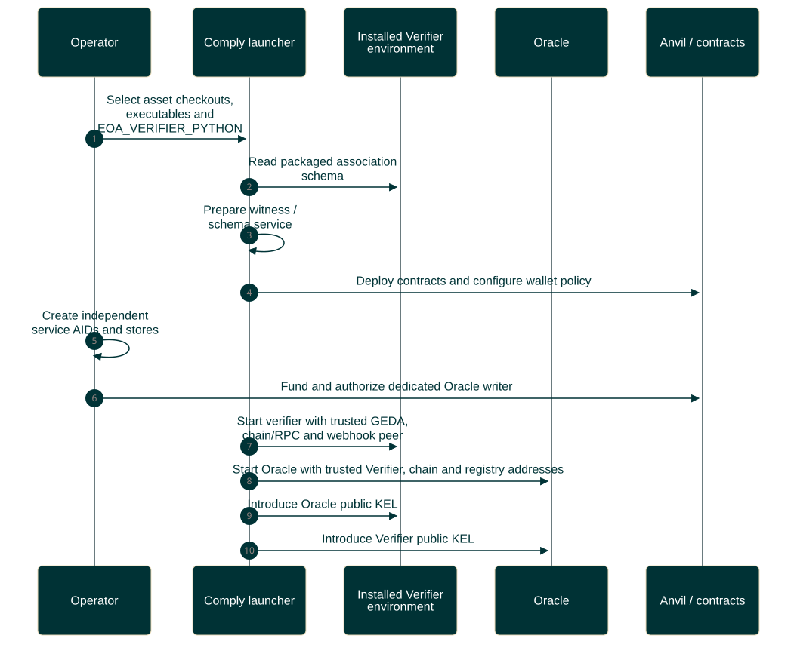
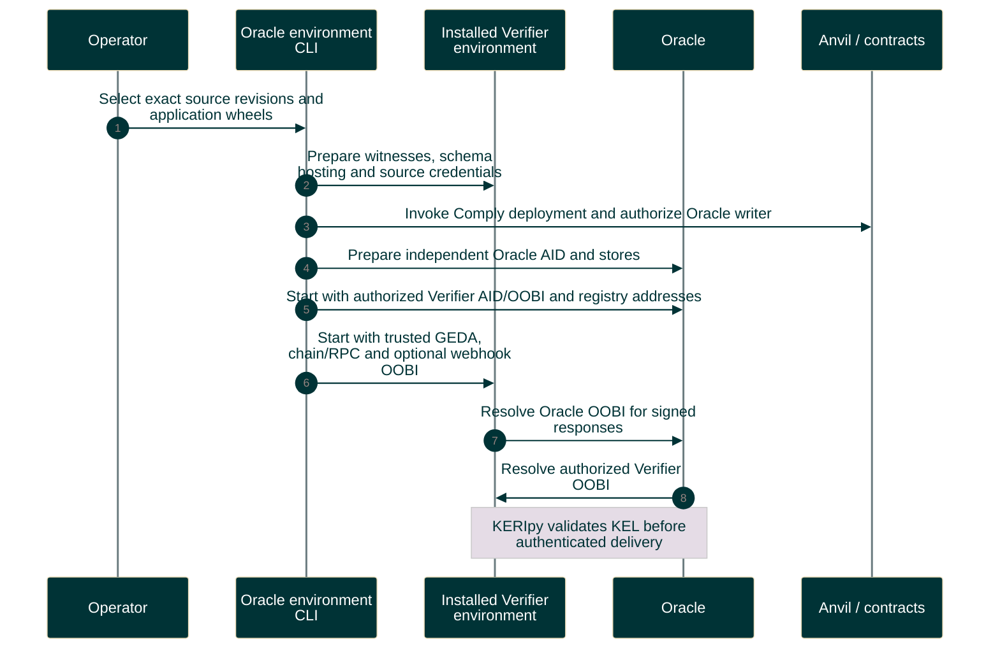

# Local independent-service setup

Use explicitly pinned installed applications, fresh demo stores and a separately authorized Oracle writer.

Editable Mermaid source

See the [portable Comply setup guide](https://github.com/GLEIF-IT/vlei-comply/blob/main/docs/gl1-vlei-local-infra-setup.md). Startup does not issue association credentials.
