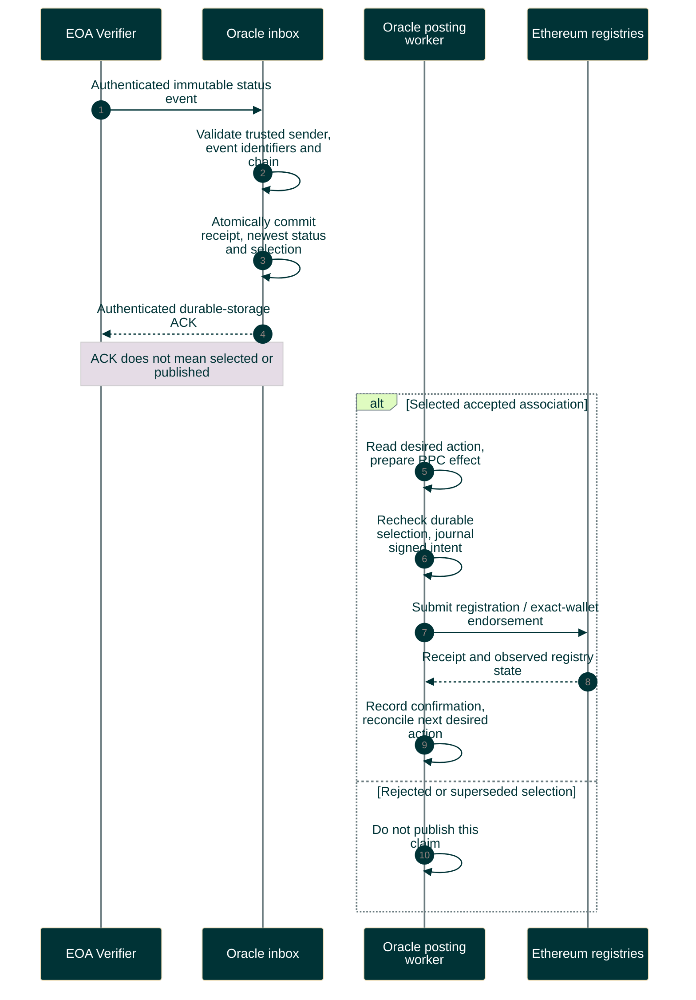

# Oracle receipt, selection and publication

Verifier has completed initial verification and application acceptance. Oracle trusts authenticated producer facts.

Editable Mermaid source

[Oracle API](../../../protocol/oracle-api-v1/README.md) defines selection and conflicts. Supersession changes Oracle selection, not Verifier acceptance. See [operations](../../status-inbox.md) for unresolved-transaction limits.
