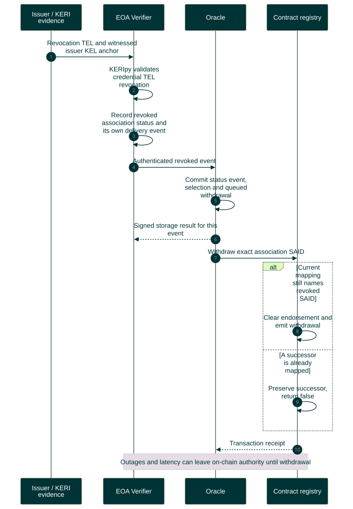
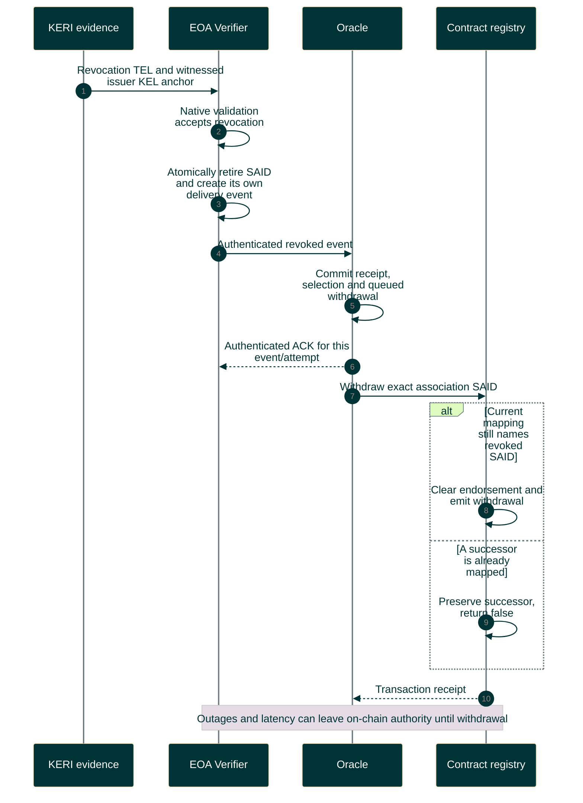

# Verified revocation and exact withdrawal

Only verified revocation retires upstream acceptance. Replacement selection does not.

Editable Mermaid source

Missing evidence is not revocation. Already confirmed token transfers are not undone. [Oracle API](../../../protocol/oracle-api-v1/README.md) and [Verifier API](https://github.com/GLEIF-IT/eoa-verifier/blob/master/protocol/verifier-api-v1/README.md) own their respective transitions.
