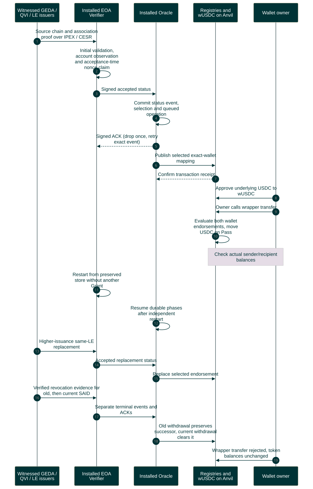
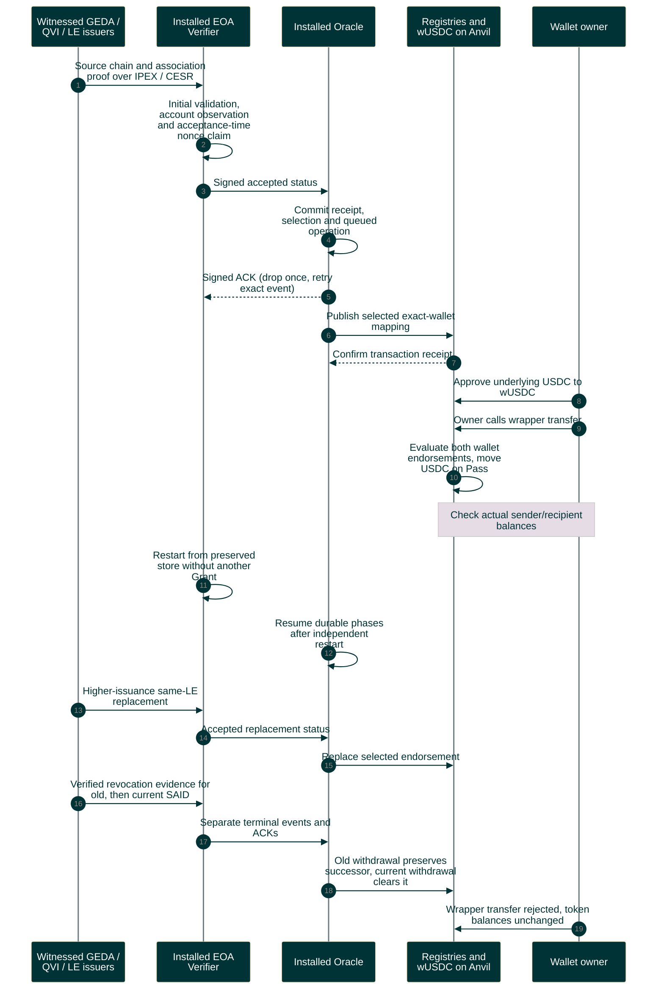

# Witnessed associations to audited token transfers

This is the single full-system scenario, maintained alongside [paired qualification](../../two-service-qualification.md). It repeats association acceptance for both wallets.

Editable Mermaid source

Selection and receipt do not change upstream acceptance. The fixture also rejects reuse of an accepted issuer/nonce by another credential. Direct USDC transfers can bypass wUSDC; its role is auditable compliance for routed transfers. No production-readiness or malformed-stream liveness claim follows from this scenario.
